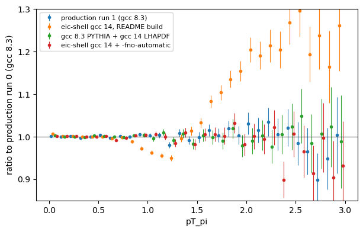

# Reproducibility validation: why `-fno-automatic` is required

## Summary

- The production samples ([`production/README.md`](../production/README.md))
  were generated with PYTHIA built by **gcc/gfortran 8.3** (CentOS 7 Fun4All
  stack on cvmfs), not in eic-shell.
- Following the top-level README in eic-shell (**gcc/gfortran 14.2**) builds
  and runs without errors and gives the same cross section and event
  kinematics. It does **not** give the same final state: the pion pT
  spectrum is about 4% lower near 1 GeV and up to about 20% higher above
  2 GeV. Charged-particle pT and momentum are also off.
- The cause is the PYTHIA6 Fortran compiled with gfortran 14. LHAPDF is not
  involved.
- Adding **`-fno-automatic`** to the Fortran flags fixes it. An eic-shell
  build with the flag agrees with the production samples in every
  distribution tested. This branch adds the flag to
  `PYTHIA-RAD-CORR/CMakeLists.txt`.



## Why the build changes the physics

The source code, PDF sets and steering cards are identical between the
production build and an eic-shell build of this repository. Only the
toolchain differs:

| | Production build | eic-shell build (README) |
|---|---|---|
| gcc / gfortran | 8.3.0 (cvmfs Fun4All, CentOS 7) | 14.2.0 (Debian, `eic_xl`) |
| LHAPDF | built with gcc 8.3 | built with gcc 14 |
| CERNLIB | cvmfs `cern64/pro` (gcc 8.3) | same |
| Fortran flags | `-fno-second-underscore -fPIC -std=legacy` | same + `-fallow-argument-mismatch` (required by gfortran ≥ 10) |

Neither build uses optimisation flags.

The production build was identified from its `CMakeCache.txt` (compiler
paths) and from the `.comment` sections of `pythia6-eic` and
`libLHAPDF.so` (`GCC: (GNU) 8.3.0`, CentOS 7 startup code).

PYTHIA6 and the PYTHIA-RAD-CORR additions are Fortran 77 code that, in
places, expects local variables to keep their values from one call to the
next without declaring them `SAVE`. The Fortran standard does not guarantee
this. gfortran 8.3 happened to keep the values in this build; gfortran 14
does not. `-fno-automatic` makes every local variable static, which is the
behaviour the code was written for. This is the usual setting for building
PYTHIA6 with modern compilers. The specific routine was not identified.

## Tests

All tests use `STEERING/card_eAg_9x100_EPPS16` (eAg, 9 × 100 GeV, EPPS16,
1 < Q² < 10 GeV²) with only the event count changed. Each run draws its own
seed. The production reference is the first 1,000,000 events of production
runs 0 and 1 (`/gpfs02/eic/gabrielg/Saturation_v6/eAg_9x100_EPPS16_{0,1}.txt`).

| Sample | PYTHIA built with | LHAPDF built with | Run in | Events |
|---|---|---|---|---|
| Production run 0, run 1 | gcc 8.3 | gcc 8.3 | (2026-07) | 1M each |
| README build | gcc 14 | gcc 14 | eic-shell | 1M (4 × 250k) |
| A: production binary, rerun | gcc 8.3 | gcc 8.3 | RHEL 9 host, no container | 500k |
| C: library swap | gcc 8.3 | gcc 14 | eic-shell | 500k |
| **Fixed build (`-fno-automatic`)** | gcc 14 | gcc 14 | eic-shell | 500k |

Test A checks that the production binary still reproduces its own output
today. Test C swaps only `libLHAPDF.so`, which `pythia6-eic` loads at
run time, to separate the PYTHIA compile from the LHAPDF compile.

`histo.py` reads the generator text output and histograms 17 distributions:
- **Event level:** y, Q², x, W², ν, final-state multiplicity and charged
  multiplicity.
- **Particle level (final state):** charged pT, η and p; π± pT and η; η of
  K±, protons and photons; η and p of the scattered electron.
- **Fractions:** subprocess (`MSUB`) and particle species.

`compare.py` applies a two-sample χ² test to each distribution (bins with
fewer than 10 combined entries dropped). Particle-level entries from one
event are correlated, so particle-level p-values are somewhat
optimistic. That is why the control comparisons (production run 0 vs run 1,
and the two halves of the README-build sample) matter.

## Results

p-values of the two-sample χ² test against production run 0 (run 1 gives
the same picture):

| Comparison | π± pT | charged pT | charged p | Verdict |
|---|---|---|---|---|
| Production run 1 (control) | 0.42 | 0.31 | 0.38 | agree |
| README build, half vs half (control) | 0.79 | 0.14 | 0.19 | agree |
| **README build (gcc 14)** | **10⁻¹¹⁹ (χ² 654/29)** | **10⁻¹¹ (150/49)** | **4·10⁻⁵ (84/39)** | **disagree** |
| A: production binary, rerun | 0.94 | 0.92 | 0.26 | agree |
| C: gcc 8.3 PYTHIA + gcc 14 LHAPDF | 0.995 | 0.997 | 0.12 | agree |
| **Fixed build (`-fno-automatic`)** | **0.57** | **0.09** | **0.41** | **agree** |

All distributions, README build vs fixed build (χ²/ndf, p):

| Distribution | README build | Fixed build |
|---|---|---|
| y | 69.0/49, 0.03 | 47.7/49, 0.52 |
| Q² | 27.9/39, 0.91 | 58.0/39, 0.03 |
| x | 33.3/30, 0.31 | 28.4/30, 0.55 |
| W² | 26.1/23, 0.29 | 21.2/23, 0.57 |
| ν | 35.7/24, 0.06 | 31.9/24, 0.13 |
| final-state multiplicity | 82.1/65, 0.07 | 76.8/64, 0.13 |
| charged multiplicity | 26.4/17, 0.07 | 14.1/17, 0.66 |
| charged pT | **150.1/49, < 10⁻¹¹** | 61.8/48, 0.09 |
| charged η | 75.6/58, 0.06 | 58.2/58, 0.47 |
| charged p | **83.7/39, < 10⁻⁴** | 40.4/39, 0.41 |
| π± pT | **654.4/29, 10⁻¹¹⁹** | 27.0/29, 0.57 |
| π± η | 70.4/58, 0.13 | 70.8/58, 0.12 |
| K± η | 65.1/55, 0.17 | 53.6/54, 0.49 |
| proton η | 57.8/52, 0.27 | 49.5/52, 0.58 |
| photon η | 64.1/58, 0.27 | 69.0/58, 0.15 |
| scattered e η | 42.2/33, 0.13 | 41.9/33, 0.14 |
| scattered e p | 60.9/45, 0.06 | 37.1/45, 0.79 |
| subprocess fractions | 17.9/10, 0.06 | 19.8/10, 0.03 |
| species fractions | 14.0/11, 0.24 | 14.5/11, 0.21 |

Out of about 20 tests, one or two values near p = 0.03 are expected by
chance. Against production run 1, the fixed build gives π± pT p = 0.88,
charged pT 0.34 and charged p 0.61.

Cross section (σ): README build 0.3125 µb (mean of 4 × 250k); production
run 0 0.3126 µb.

Full overlays with ratio panels:
[README build](img/all_readme_build.png),
[fixed build](img/all_fno_automatic.png).

### Limitations

- Only eAg 9x100 was tested. ep and eAu use the same binary and code
  paths, so the same result is expected but was not checked.
- A gcc 8.3 build *with* `-fno-automatic` was not tested.
- Test A showed one low p-value (final-state multiplicity, p = 0.001) that
  did not appear in any other comparison of gcc 8.3 output, including
  production run 0 vs run 1 (p = 0.23) and test C (p = 0.12). Most likely
  a statistical fluctuation of that one sample.
- The generator seeds come from `/dev/urandom` and cannot be set, so the
  comparisons are statistical, not event by event.

## Rerunning the tests

Inside eic-shell, after building with this branch and sourcing
`scripts/load-env.sh`:

```bash
mkdir -p val && cd val
sed -e '1s/.*/new_0.txt ! output file name/' -e '4s/.*/250000,100 ! Number of events/' \
    ../STEERING/card_eAg_9x100_EPPS16 > card
../PYTHIA-RAD-CORR/build/pythia6-eic < card > log 2>&1

python3 ../validation/histo.py new.npz 250000 new_0.txt
python3 ../validation/histo.py prod.npz 1000000 /gpfs02/eic/gabrielg/Saturation_v6/eAg_9x100_EPPS16_0.txt
python3 ../validation/compare.py prod.npz new.npz all.png "production" "this build"
python3 ../validation/ratio.py pT_pi pT_pi.png prod.npz "production" new.npz "this build"
```

Run the generation in parallel jobs (one card per job) to get more
statistics. 250k events take about 5 minutes and 1.8 GB of disk. `histo.py`
reads about 3 s per 20k events. Run the plotting scripts inside the
container, since the host Python may not have matplotlib.
